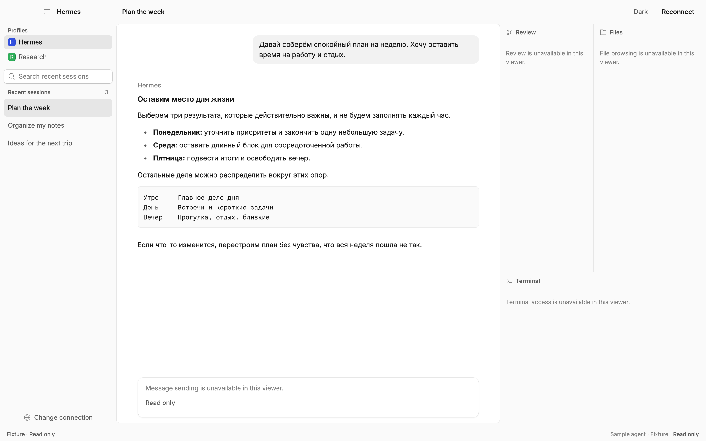
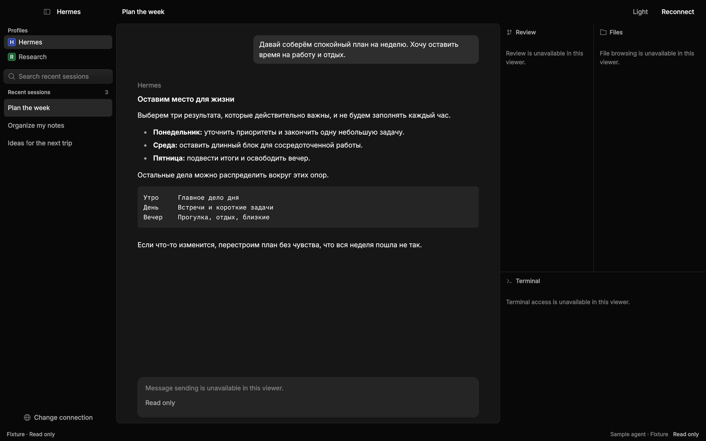

# Hermes Desktop Rune: native reader

The first native Rune increment reads an existing Hermes gateway. It preserves
the Hermes Default panel topology and uses the real OpenCode Rune kit, theme,
fonts and icons. The Electron client remains the behavioral baseline.

## Run

Rust 1.95+ and native Linux headers `libxkbcommon-dev`, `libwayland-dev` are
required. A GPU/Vulkan driver is needed; Mesa software Vulkan works in a VM.

```sh
npm run dev:rune
npm run dev:rune -- --local-home /absolute/path/to/hermes-home
npm run dev:rune -- --gateway http://127.0.0.1:9000
npm run test:rune
```

A URL token can be entered in the secure connection form or supplied through
`HERMES_GATEWAY_TOKEN`. Tokens are transient, never persisted or printed. This
increment does not yet persist connection choices or theme preferences.

Local mode currently supports Linux and attaches to an **already-running** gateway through its private
control socket and one-use tickets. It never invokes `gateway ensure`, starts,
updates or stops an agent. URL mode supports gateway token authentication.
OAuth and SSH UI are later migration work; they are not silently emulated.

The current minimum native window width is 1024 logical pixels, until the full
responsive pane tree is ported.

The native reader supports profile selection, saved session listing, Markdown
history, search, manual reconnect and both appearances. History initially shows
the latest 500 messages; an explicit notice indicates when earlier history is
not loaded. The session list contains the latest 200 visible stored sessions. Search filters
that loaded list. Image attachments are not rendered in this text/Markdown slice.
Send/stream/stop, approvals, editing, Bot Chat-specific navigation,
terminal, file/review interactions, previews, other settings/routes and JS GUI
plugins are later increments. The unavailable tool panes and composer are
explicitly read-only. This is not full behavior parity.

## Reproducible visual checks

```sh
cargo run --manifest-path apps/rune/Cargo.toml -- \
  --scene reader --theme dark --size 1440x900 --snap /tmp/hermes-rune-dark.png
cargo run --manifest-path apps/rune/Cargo.toml -- \
  --scene reader --theme light --size 1440x900 --snap /tmp/hermes-rune-light.png
```

Named scenes contain synthetic content only. Fixture mode never falls back to a
live server, and a failed live connection never displays synthetic conversation
history. The headless tooling does not run the native window's `on_ready`, so it
is for deterministic presentation checks, not proof of a live connection.
`--check-connection --local-home PATH` performs a read-only production transport
probe and prints counts only, not private titles, messages or credentials.

## Upstream reuse and limits

Runtime, rune-kit and rune-theme-opencode are pinned together in Cargo.toml.
Selected real OpenCode view functions are adapted from the last containing
reference tree, `3f70cd6b675c89a8a7b64fc09b1bf2b455e0ad1a`. See
[reuse.md](docs/reuse.md) and [licenses](licenses).

Rune's current semantic tree has no OS screen-reader bridge. Native OS menus,
voice and drag/drop also have platform-specific gaps. Native terminal, embedded
browser and React plugin compatibility need separate integrations. A screenshot
or tree does not prove these capabilities. macOS and Windows have not been
verified for this increment.

## Verification commands

```sh
cargo fmt --manifest-path apps/rune/Cargo.toml --check
npm run test:rune
cargo build --locked --manifest-path apps/rune/Cargo.toml
npm run test:rune:ui
```

The UI checker uses only Node standard libraries and synthetic Rune scenes. It
checks both appearances and panel layout, filtered session search, secure input
redaction, Escape dismissal and the network error state. It needs a Vulkan
renderer (Mesa software rendering is sufficient); transport unit tests do not.
See [the port plan](docs/port-plan.md) for subsequent behavior slices.



