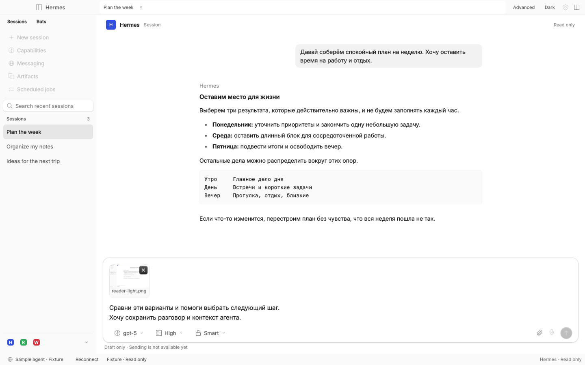
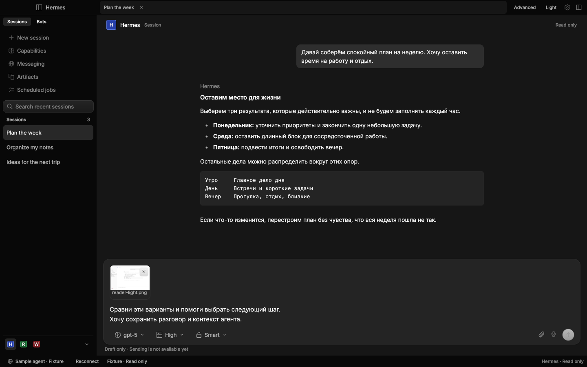
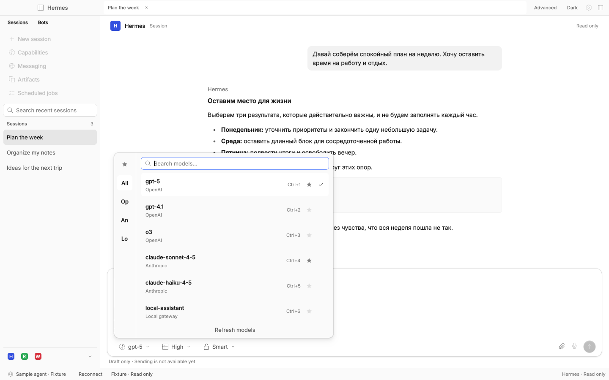
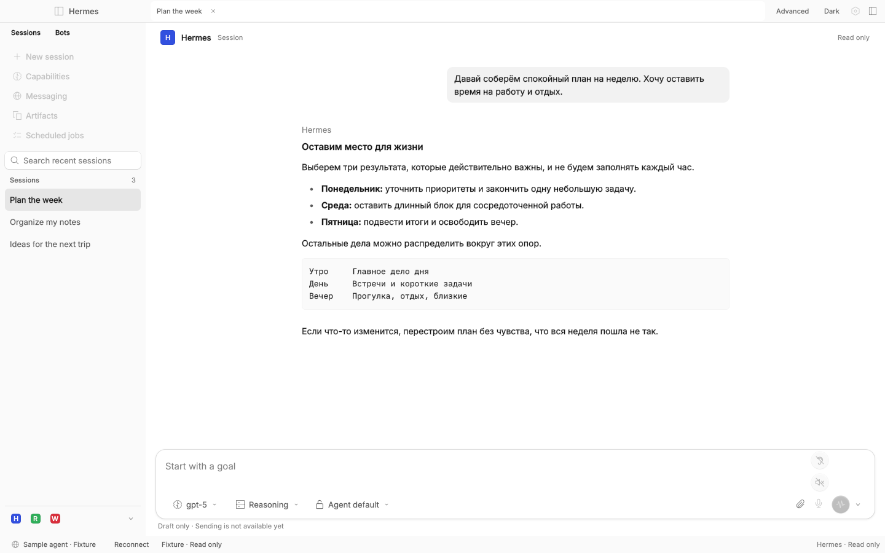
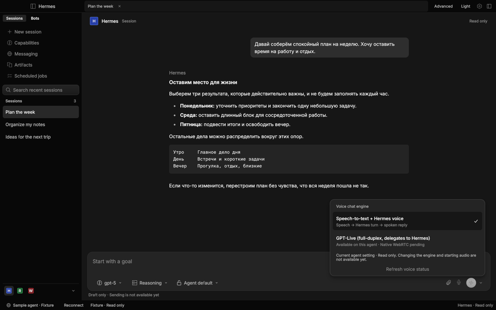
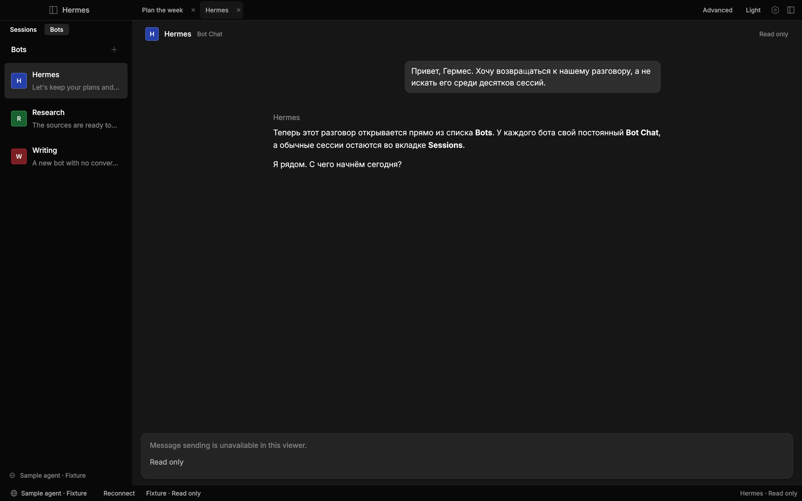

# Hermes Desktop Rune: native reader and composer

The native Rune increment reads an existing Hermes gateway. Its shell follows
the retained Hermes client: Sessions / Bots in one left zone, the original
navigation order, profile scope at the sidebar foot and workspace conversation
tabs. OpenCode supplies widgets, themes, fonts and icons. The Electron client
remains the behavioral baseline; this is still a partial read-only port.

## Run

Rust 1.95+ and native Linux headers `libxkbcommon-dev`, `libwayland-dev` are
required. A GPU/Vulkan driver is needed; Mesa software Vulkan works in a VM.

```sh
npm run dev:rune
npm run dev:rune -- --local-home /absolute/path/to/hermes-home
npm run dev:rune -- --gateway http://127.0.0.1:9000
npm run test:rune
```

A URL token can be entered in the secure connection form or supplied through
`HERMES_GATEWAY_TOKEN`. Tokens are transient, never persisted or printed. This
increment does not yet persist connection choices or theme preferences.

Local mode currently supports Linux and attaches to an **already-running** gateway through its private
control socket and one-use tickets. It never invokes `gateway ensure`, starts,
updates or stops an agent. URL mode supports gateway token authentication.
OAuth and SSH UI are later migration work; they are not silently emulated.

The current minimum native window width is 1024 logical pixels, until the full
responsive pane tree is ported.

The native reader supports profile selection, saved session listing, Markdown
history, search, manual reconnect and both appearances. Bots opens the server's
canonical Bot Chat directly, refreshing its registry identity on every open.
Canonical Bot Chats stay out of Sessions. A bot without an existing Bot Chat
shows an empty state; viewing never creates a chat or adopts its newest session.
Ordinary clicks open in place. Right-click a session or bot for Open in new tab.
Simple mode rests tooling and the statusbar; connection recovery stays available.
Tooling starts closed in Advanced too, matching a fresh Hermes install. The
right-side toggle reveals its deferred panel slots for layout inspection.

History initially shows
the latest 500 messages; an explicit notice indicates when earlier history is
not loaded. The session list contains the latest 200 visible stored sessions. Search filters
that loaded list. Historical image attachments are not rendered in this text/Markdown slice.
Send/stream/stop, approvals, editing, bot creation/custom avatars/groups,
terminal, file/review interactions, previews, other settings/routes and JS GUI
plugins are later increments. Tool panes remain unavailable. History remains
read-only; the composer now edits local drafts without submitting them. This
is not full behavior parity.
See [the shell parity inventory](docs/shell-parity.md) for precise coverage.

## Composer and model picker

The user-selected T3 Code composition is implemented with native Rune controls:
multiline draft text, removable local attachment tiles with image previews,
model/reasoning/service-tier/approval controls and an above-field model picker.
The picker reads the selected external agent's real `model.options` catalog,
with a same-owner authenticated REST fallback. It supports search, provider
filtering, favorites, current-choice checks, immediate keyboard search,
Up/Down/Enter and Cmd/Ctrl+1…9. Catalog loading has a separate worker and cannot
cancel history reads. Large model lists are virtualized.

Selections are **staged draft settings**, not changes to the agent or metadata
about archived history. Reasoning and fast tiers are gated by advertised model
capabilities. Hermes keeps its actual approval modes (Manual, Smart, Off);
T3-specific modes are not invented. Drafts, attachments and favorites currently
live in memory, scoped by connection/profile/conversation as appropriate.

The paperclip opens a native file chooser (XDG portal on Linux), stages an
explicitly chosen local file and reads supported image previews locally.
Nothing is uploaded. Removal does not delete the file. On desktops without a
working portal, a labelled error is shown. The mic reveals Hermes's separate
spoken-replies and wake-word controls on hover or keyboard activation; native
audio capture/playback, actual dictation, wake listening and send remain disabled.

An empty draft shows a separate waveform action for voice conversation and an
engine chevron; text or attachments replace it with Send. The chevron reads
the owning agent's `voice-live/status` in a separate worker. Confirmed chained
versus GPT-Live selection and live availability are shown read-only. No engine
configuration is written and neither action opens the microphone. See
[voice-parity.md](docs/voice-parity.md) for the full audio/state contract and
[lower-left-parity.md](docs/lower-left-parity.md) for every rail, nested menu,
Command Center and statusbar feature still to transfer. Their functions remain
in scope; the original control density is not a design requirement.

Use `--scene composer`, `models`, `reasoning`, `permissions` or `voice` to inspect
synthetic native states. `--check-connection ... --check-models` probes a fresh
production model-catalog connection and prints only provider/model counts.
Use `--scene voice-chat` or `voice-engine` for the empty-composer voice states;
`--check-connection ... --check-voice` reads engine/availability without audio.

## Reproducible visual checks

```sh
cargo run --manifest-path apps/rune/Cargo.toml -- \
  --scene reader --theme dark --size 1440x900 --snap /tmp/hermes-rune-dark.png
cargo run --manifest-path apps/rune/Cargo.toml -- \
  --scene reader --theme light --size 1440x900 --snap /tmp/hermes-rune-light.png
```

Named scenes contain synthetic content only. Fixture mode never falls back to a
live server, and a failed live connection never displays synthetic conversation
history. The headless tooling does not run the native window's `on_ready`, so it
is for deterministic presentation checks, not proof of a live connection.
`--check-connection --local-home PATH` performs a read-only production transport
probe and prints counts only, not private titles, messages or credentials.
Add `--check-bot` to probe existing canonical Bot Chat history specifically;
absence is reported without creating one.

## Upstream reuse and limits

Runtime, rune-kit and rune-theme-opencode are pinned together in Cargo.toml.
Selected real OpenCode view functions are adapted from the last containing
reference tree, `3f70cd6b675c89a8a7b64fc09b1bf2b455e0ad1a`. See
[reuse.md](docs/reuse.md) and [licenses](licenses).

Rune's current semantic tree has no OS screen-reader bridge. Native OS menus,
voice and drag/drop also have platform-specific gaps. Native terminal, embedded
browser and React plugin compatibility need separate integrations. A screenshot
or tree does not prove these capabilities. macOS and Windows have not been
verified for this increment.

## Verification commands

```sh
cargo fmt --manifest-path apps/rune/Cargo.toml --check
npm run test:rune
cargo build --locked --manifest-path apps/rune/Cargo.toml
npm run test:rune:ui
npm run test:rune:composer
```

The UI checker uses only Node standard libraries and synthetic Rune scenes. It
checks Hermes structure and both appearances, revealed panel geometry, filtered
search, secure input, Escape, errors, canonical bot navigation, explicit tabs,
missing Bot Chat and Simple-mode recovery. It needs a Vulkan
renderer (Mesa software rendering is sufficient); transport unit tests do not.
The separate composer checker covers the field, provider/search/favorite
filters, keyboard selection, draft settings, voice reveal, file chooser and a
short dark window. See [the port plan](docs/port-plan.md) and
[screenshot comparison](docs/screenshot-parity.md) for subsequent slices.








