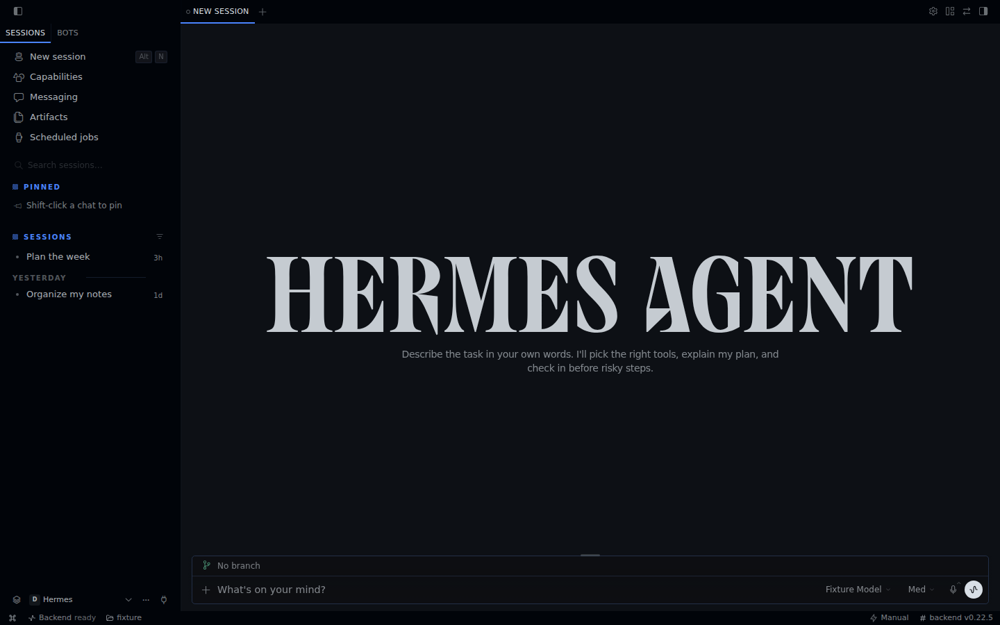
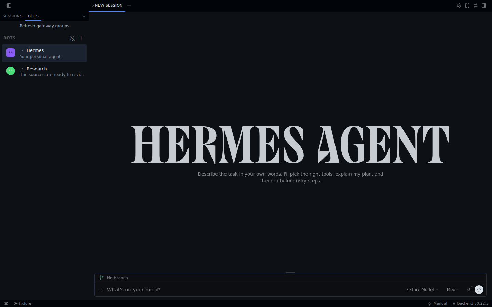

# Hermes shell contracts and current coverage

The user rejected commit 6001795's composition. Its native runtime and live
transport worked, but the OpenCode Sidebar/Toolbar shell did not preserve
Hermes's navigation and bot identity model. This inventory replaces the broad
claim that matching DEFAULT_TREE established a transferred Hermes interface.

| Contract | Retained source | Current native scope |
| --- | --- | --- |
| Sessions / Bots share the left zone, with their strip below window controls | `plugins/hermes-bots/plugin.tsx`, `components/pane-shell/tree/renderer/tree-group.tsx` | Both real surfaces; no top Profiles list |
| New session, Capabilities, Messaging, then Advanced Artifacts and Scheduled jobs | `app/chat/sidebar/index.tsx` | Original order above search; these destinations are visibly disabled pending their slices |
| Profile scope lives at the Sessions pane foot | `app/chat/sidebar/profile-switcher.tsx` | Scrollable profile rail plus full profile picker |
| A bot row opens its named canonical Bot Chat | `plugins/hermes-bots/canonical-chat.ts`, `src/AGENTS.md` | Fresh `profiles.list(include_sessions:true)` on every bot open; direct read-only canonical history; no newest-session fallback |
| Canonical chats never appear among ordinary Sessions | `plugins/hermes-bots/session-sweep.ts` | Read-time exclusion by canonical identity and exact title/root_title; no visibility mutation |
| Plain opens replace foreground; explicit tab opens preserve it; existing tabs are focused | `plugins/hermes-bots/canonical-chat.ts`, host session opening | In-place row clicks and right-click Open in new tab, owned by profile/session; closing active tab selects a remaining one |
| Default panel slots are independent of visibility | `app/contrib/layout-presets.ts`, `store/layout.ts`, `store/review.ts` | Sessions left, main center; revealed Review/Files upper right and Terminal below; deferred tooling starts closed |
| Simple mode shadows Advanced preferences | `store/interface-mode.ts` | Tool visibility/restoration and nav tier filtering, statusbar hidden; connection and retry remain available |
| Context changes never paint another identity's transcript | session focus/store contracts | Intent-fenced reads and instant workspace replacement, including native transition frames |
| Connection chooser belongs to app chrome | `app/shell/hooks/use-statusbar-items.tsx` | Gateway action and retry in statusbar, direct connection action in Simple |

## Explicitly incomplete

The navigation destinations, session creation/sending, concurrent live chat
state, custom avatar assets and animated faces, bot editing/groups/routines,
multi-gateway fleet, pinned/project/messaging sidebar sections, pane drag/drop,
all presets and persistence are not fully migrated. Review/Files/Terminal are
unavailable panel slots, not working tools. Split geometry is limited to the
default arrangement; previews and secondary windows are later slices.

This correction restores the reader's Hermes shell and canonical bot doorway.
It does not establish full Hermes Desktop parity or completion of the migration.

## Visual evidence

Reference captures use the retained compiled Hermes React renderer with fully
intercepted synthetic HTTP/WebSocket responses. They establish shell geometry,
not native Electron acceptance or canonical history behavior. Native captures
come from the real Rune executable with synthetic fixtures. Real private agent
history is never used in committed screenshots.

